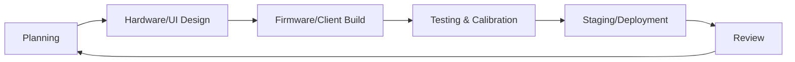
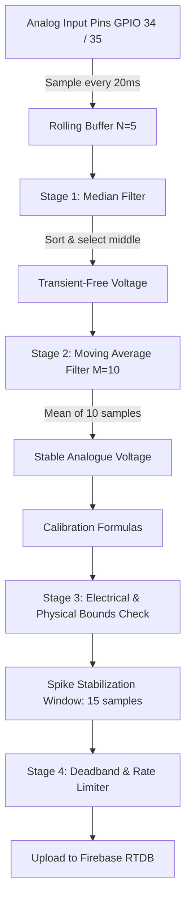

# System Methodology & Architecture

This document details the engineering methods, mathematical calibrations, data filtering algorithms, and software development cycles utilized in the **MSU Water Monitoring & Control System**.

---

## 1. Development Methodology

The project was developed using the **Agile Development Model (Scrum Framework)**. This methodology was selected to handle hardware-firmware-software constraints iteratively across modular layers:



1. **Modular Architecture Sprints**:
   - Edge firmware (`backend/firmware/esp32_firmware.ino`) runs FreeRTOS dual-core tasking: `sensorTask` on Core 1 (priority 2) for deterministic 20ms ADC sampling, and `networkTask` on Core 0 (priority 1) for HTTPS/TLS communications.
   - Cloud rules (`backend/cloud/database.rules.json`, `backend/cloud/firestore.rules`) secure real-time messaging and account roles.
   - Frontend web application (`frontend/`) and mobile wrapper (`mobile/`) consume centralized state from Firebase.
2. **Continuous Signal & Connectivity Refinement**: Real-world water turbulence, sensor drift, and reservoir network dropouts prompted sprints dedicated to 4-stage digital filtering, zombie-socket watchdog recovery, and an offline 20-entry RAM ring buffer.
3. **Cross-Platform Deployments**: A unified React 18 + TypeScript codebase compiles to a responsive Web SPA (Vite) and an Android native wrapper (Capacitor).

---

## 2. Sensor Processing & Signal Filtering Algorithms

Raw analog signals from the pH electrode and hydrostatic level sensor are susceptible to electromagnetic pump noise, water turbulence, and voltage ripple. The ESP32 executes a **4-stage non-blocking digital filter and validation pipeline**:



### 2.1 Execution Scheduling
- **Raw Sampling Interval (`SENSOR_SAMPLE_INTERVAL`)**: `20 ms` (50 Hz). `sampleSensorsNonBlocking()` executes on Core 1, pushing voltages into circular buffers. Each sample is the average of 16 ADC conversions. The level sensor (GPIO 35) uses `analogReadMilliVolts()`, which applies the ESP32's factory ADC calibration (eFuse), so its voltage matches a multimeter; the plain `(analogRead(pin) / 4095.0) * 3.3` conversion read about 0.2 V low on Tank 1 (0.60 V vs 0.80 V empty, 1.17 V vs 1.37 V full). The pH sensor (GPIO 34) still uses the plain conversion so its existing calibration stays valid.
- **Processing Interval (`SENSOR_PROCESSING_INTERVAL`)**: `200 ms` (5 Hz). Runs full filtering, calibration, spike evaluation, and alert checks.
- **Telemetry Upload Rate Limit**:
  - Minimum write interval (`MIN_WRITE_INTERVAL`): `1,000 ms` (1 second).
  - Telemetry heartbeat interval (`SENSOR_WRITE_HEARTBEAT`): `10,000 ms` (10 seconds forced write if stable).
  - History sampling interval (`HISTORY_SAMPLE_INTERVAL`): `600,000 ms` (10 minutes).

### 2.2 Stage 1: Median Filter
* **Purpose**: Eliminates high-amplitude transient spikes caused by bubbles, electrical switching, or pump start surges.
* **Logic**: Raw readings are stored in a 5-element circular array (`FILTER_MEDIAN_WINDOW = 5`). A non-blocking bubble sort arranges samples to extract the true median (index 2):
  ```cpp
  void sortArray(float arr[], int n) {
    for (int i = 0; i < n - 1; i++) {
      for (int j = 0; j < n - i - 1; j++) {
        if (arr[j] > arr[j + 1]) {
          float temp = arr[j];
          arr[j] = arr[j + 1];
          arr[j + 1] = temp;
        }
      }
    }
  }
  ```

### 2.3 Stage 2: Moving Average Filter
* **Purpose**: Suppresses high-frequency analog ripple to produce a steady DC voltage.
* **Logic**: The median filter output is appended to a circular average buffer (`FILTER_AVERAGE_WINDOW = 10`). The arithmetic mean of the last 10 samples represents the filtered voltage ($V_{stable}$).

### 2.4 Stage 3: Bounds Validation & Spike Rejection
1. **Electrical Voltage Bounds**:
   - Safe operational limits: level sensor $0.30\text{V} < V_{raw} < 3.25\text{V}$ (`LEVEL_MIN_VALID_VOLTAGE`); pH sensor $0.05\text{V} < V_{raw} < 3.25\text{V}$.
   - Voltages at or below the lower limit (open circuit / disconnected wire) or $\ge 3.25\text{V}$ (short circuit to rail) trigger a fault timer.
   - Why 0.30 V for the level sensor: a 100 kΩ pull-down on GPIO 35 (`docs/Level_Sensor_RC_Filter_Wiring.md`) pulls a disconnected HW-685 output to 0 V, but the ESP32 ADC reports about 0.14 V for 0 V, so a 0.05 V limit never fired. On Tank 1 (20 Nov 2026) the unplugged sensor was caught only by the height check (−0.52 m against −0.5 m). An empty tank reads at least 0.50 V (ZERO is never set lower), so 0.30 V separates the two with margin.
   - If an electrical fault persists for $\ge 10,000\text{ ms}$ (`SENSOR_FAULT_TIMEOUT`), the sensor health is set to `false`, an emergency error is logged, and the pump is prevented from auto-starting.
   - Monitoring is never suspended by a fault. During the 10 s check the last good value is held (so a short glitch does not show); once the fault is confirmed, the live reading, clamped to the physical range (pH 0 to 14, level 0 to 100 %), keeps going to the dashboard, the 10-minute history and the alerts, flagged by `levelSensorOk` / `phSensorOk = false`. Threshold alerts (low water, overflow, pH) keep being evaluated and say that the reading may be inaccurate. Only the pump is held off while the level sensor is faulty.
   - Recovery requires stable readings for at least $3,000\text{ ms}$.
2. **Physical Environmental Bounds**:
   - pH: $0.0 \le \text{pH} \le 14.0$
   - Water Height: $-0.5\text{m} \le \text{Height} \le (\text{Tank Height} + 0.5\text{m})$
3. **Level Signal Stability (disconnected sensor)**:
   - A disconnected or broken level sensor leaves GPIO 35 floating; the reading then wanders across the range (observed on Tank 1: 0 → 57 → 0 % within a minute) while staying inside the bounds above.
   - The ESP32 keeps the minimum and maximum level per second for the last 30 s (`LEVEL_STABILITY_WINDOW_S`). A swing of $\ge 25\%$ (`LEVEL_UNSTABLE_RANGE`) within that window makes the reading invalid; after `SENSOR_FAULT_TIMEOUT` (10 s) the level sensor is flagged faulty and the fault log says "Unstable readings". A real 200 L drum cannot change that fast (25 % in 30 s is about 100 L/min).
4. **Spike Stabilization Window**:
   - If a step change exceeds the spike threshold ($\Delta\text{pH} \ge 1.50$ or $\Delta\text{Level} \ge 15\%$), it is ignored until confirmed across **15 consecutive samples** (`STABILIZATION_SAMPLES = 15`), preventing physical sloshing or turbulence from generating false triggers.

### 2.5 Stage 4: Deadband Filtering
To minimize unnecessary database writes and save cellular/Wi-Fi bandwidth, data writes to Firebase are gated by a deadband check:
* **Water Level Deadband (`WATER_LEVEL_DEADBAND`)**: **2%** change.
* **pH Level Deadband (`PH_LEVEL_DEADBAND`)**: **0.15 pH** change.
* Telemetry is only pushed to `/tanks/1` if the reading exceeds these offsets from the last sent value, or when the 10-second heartbeat timer elapses.

---

## 3. Mathematical Calibration Models

The system converts calibrated voltage readings into metric and percentage values. Calibration parameters are synchronized dynamically from Firebase RTDB without reflashing the firmware.

### 3.1 Hydrostatic Level Calibration
The submersible pressure sensor outputs an analog voltage proportional to hydrostatic water depth ($P = \rho g h$):

$$\text{Height (meters)} = (V_{raw} - V_{min}) \times \left( \frac{\text{Tank Height}}{V_{max} - V_{min}} \right)$$

$$\text{Clamped Height} = \text{Clamp}(\text{Height}, \ 0.0, \ \text{Tank Height})$$

$$\text{Level (percentage)} = \text{Clamp}\left( \left( \frac{\text{Clamped Height}}{\text{Tank Height}} \times 100 \right) + \text{Level Offset}, \ 0, \ 100 \right)$$

* **Default Parameters**:
  - $V_{min}$ (`levelVmin`): `0.25 V` (empty tank sensor floor)
  - $V_{max}$ (`levelVmax`): `3.00 V` (full tank sensor ceiling)
  - Tank Height (`tankHeight`): `5.00 m`
  - Level Offset (`levelOffset`): `0.00 %`

### 3.2 pH Calibration
The glass electrode potential varies linearly with hydrogen ion concentration according to the Nernst equation:

$$\text{pH} = 7.0 + \left( \frac{V_{neutral} - V_{raw}}{\text{Slope}} \right) + \text{pH Offset}$$

* **Default Parameters**:
  - Neutral Voltage (`phNeutralVoltage`): `2.50 V` (reading at pH 7.00 buffer)
  - Slope Sensitivity (`phSlope`): `0.18 V/pH`
  - pH Offset (`phOffset`): `0.00`

### 3.3 Live Sensor Readings for Calibration
The Admin Panel (Sensor Calibration, `LiveCalibrationPanel.tsx`) replaces the USB Serial Monitor:
1. **Start** writes `tanks/{id}/calibrationUntil` (server time, 10 minutes ahead; **+10 min** extends it,
   at most 30 minutes ahead, also enforced by the database rules).
2. While that time is in the future, the ESP32 adds `calibrationLive` to its normal sensor upload once per
   second: filtered level voltage (V), height from the current $V_{min}$/$V_{max}$ (m, not clamped), level
   percentage and filtered pH voltage. No extra request is made and no history is written.
3. The firmware stops sending at `calibrationUntil`, after 30 minutes on its own (`CALIB_LIVE_MAX_MS`), or
   while its NTP clock is not set. A reading older than 8 s is shown as "Waiting for readings".
4. **Use as Vmin / Vmax / pH neutral** copies the live voltage into the form; **Save** applies it.

All four sketches (Tanks 1–4) support it.

---

## 4. Control Rules, Safeguards & Network Failover

### 4.1 Automatic Pump Control Logic
Pump control is executed deterministically on Core 1 by `processAutomaticPumpControl()`:
1. **Low-Level Refill Trigger**:
   - When water level falls to $\le \text{lowLevelThreshold}$ (default **15%**), the pump is **started** automatically.
   - **Anti-Chatter Cooldown**: Must satisfy `now - lastPumpStopTime >= 30,000 ms` (`PUMP_MIN_OFF_TIME = 30s`) before starting, preventing relay rapid-cycling.
2. **Overflow Shutoff Protection**:
   - When water level reaches $\ge \text{overflowThreshold}$ (default **95%**), the pump is **stopped** immediately.
3. **Safety Interlocks**:
   - If maintenance is on, the pump is forced **OFF** and automatic/manual starts are locked out. Maintenance is either
     system-wide (`config/maintenanceMode`) or for this tank only (`tanks/{id}/maintenanceMode`, read with the 1 s command
     poll). On the web side the same two switches pause the tank's alerts, night watch and offline notice
     (`isTankInMaintenance()` in `alertEngine.ts`); the other tanks keep working.
   - If `levelSensorOk == false`, the pump is forced **OFF** to avoid dry-running or unmonitored filling.
   - If `pumpControlLock == true`, manual toggles by Worker operators are rejected; only Admins can override.

### 4.2 Network Failover & Resilience
1. **Dual-Interface Failover**:
   - Primary: W5500 Ethernet over SPI (SCK: GPIO 18, MISO: GPIO 19, MOSI: GPIO 23, CS: GPIO 5, INT: GPIO 4, RST: GPIO 14).
   - Backup: Wi-Fi 2.4GHz with exponential retry backoff (15s $\rightarrow$ 30s $\rightarrow$ 60s max).
   - Ethernet priority: when Ethernet gets an IP address it becomes the default route (`ETH.setDefault()`), so traffic uses Ethernet whenever it is up and healthy.
   - Slow or no internet on Ethernet: 3 command polls in a row that fail or take longer than 4 s switch traffic to Wi-Fi while the cable stays connected. Ethernet is tried again every 60 s (at once if Wi-Fi drops) and kept if its polls are good.
   - Hot standby: while Ethernet is up, Wi-Fi stays joined (re-joined in the background at most every 60 s if it drops).
   - Switch-over: when the cable is unplugged, `startWifiFailover()` closes the TLS socket that was on Ethernet, clears the poll backoff, makes Wi-Fi the default route and polls at once. If Wi-Fi has not reached Firebase within 10 s, Wi-Fi is re-joined for a fresh DHCP lease (Ethernet's DHCP may have left its own DNS servers in place).
   - Readings first: right after any switch (to Wi-Fi or back to Ethernet) the sensor upload goes out before command polls and log entries (held up to 5 s; held logs are queued in RAM and keep the ESP32 local time in their text), so the dashboard shows the switch at once.
   - Return to Ethernet: when the cable is plugged back in, Ethernet must get an IP within 3 s; otherwise the W5500 is restarted (`ETH.end()` / `ETH.begin()`, hardware reset through RST), because after a re-plug it often gets no IP on its own. While Ethernet has no IP, Wi-Fi stays the default route. A lost Ethernet IP (`ETH_LOST_IP`) is handled like an unplug. The return is logged as "Ethernet connection restored".
   - Measured on 17 Nov 2026 (Tank 1, cable unplugged about 2 min, three trials, times from the board's serial log): first sensor upload over Wi-Fi 0.7 s after the board saw the unplug (Wi-Fi poll confirmed at 1.4, 2.7 and 1.4 s); back on Ethernet 1.6, 8.3 (W5500 restart needed) and 2.3 s after re-plug. The board checks the Ethernet link every 2 s, so up to 2 s more passes between the actual unplug and the board noticing it.
2. **Network Zombie-Socket Watchdog**:
   - If HTTPS requests fail continuously for $\ge 90\text{ seconds}$ despite `WL_CONNECTED`, `checkNetworkWatchdog()` tears down the TCP socket and triggers a full Wi-Fi reconnection. The new connection then gets a fresh 90 s before it is judged again.
3. **Cloud Watchdog (last-resort restart)**:
   - If nothing has reached Firebase for 3 minutes, on Ethernet or Wi-Fi, `checkCloudWatchdog()` restarts the ESP32. It waits while the pump is ON (the pump logic is local and must not be cut). If the internet stays down, the wait doubles after each such restart (3, 6, 12, 24 min); one successful request resets it to 3 min.
   - Reason: the logs of 13 to 17 Nov 2026 showed 12 outages longer than 5 minutes (the longest about 10 h) that ended only when the board was power-cycled, while its power LED stayed on.
   - After each start the controller logs the reset reason (`esp_reset_reason()`: power-on, task watchdog, brownout, or its own cloud-watchdog restart) under "System Power Tracker". Watchdog, crash and brownout resets are logged as ERROR.
4. **Request Timeouts**:
   - Every Firebase request has a 5 s read timeout and a 10 s TLS handshake limit (the core default is 120 s). The old 1.5 s read timeout was shorter than a normal command poll at the site (1.5 to 3.8 s), so many uploads failed with HTTP -11.
   - The sensor upload uses the same keep-alive TLS connection as the command poll instead of a new handshake every upload.
   - The 30 s task watchdog is fed before each request, so a loop with several slow requests (for example a RAM log flush) does not reset the board; a single hung request still does.
   - Command polls slower than 4 s are counted and logged as one summary at most every 10 min (one log per slow poll above 1.5 s wrote 4,265 entries in 4 days).
5. **Offline RAM Ring Buffer**:
   - Core 1 buffers up to 20 critical/error log entries in a RAM ring buffer (`ramLogBuffer[20]`).
   - When network connectivity is restored, `flushRamLogBuffer()` pushes all buffered events to Firebase `/logs`.

---

### 4.3 Night Watch: Leak and Open-Faucet Detection
No water is used at the MSU Motor Pool at night, so between `nightStartHour` and `nightEndHour`
(default **10 PM to 3 AM**, Philippine time, UTC+8) any fall in the water level means water is
leaving the tank: a leak or a faucet left open. A level sensor alone cannot tell the two apart, so
the alerts name both. The check runs in the alert worker (and in an open dashboard while the worker
is down), in `evaluateNight()` in `frontend/src/lib/alertEngine.ts`. The firmware is not changed.

1. **Fast drop (open faucet, burst pipe)**: the level is compared with the highest level of the last
   **30 min** (`NIGHT_FAST_WINDOW_MS`). A drop of `nightFastDropPercent` (default **5 %**) or more that
   is still there after **60 s** (`NIGHT_DRAIN_CONFIRM_MS`) raises **"Possible Leak or Open Faucet"**
   (danger, push notification, repeated until acknowledged). It recovers ("Night Water Loss Stopped")
   once the level has not fallen further for **15 min** (`NIGHT_STEADY_MS`).
2. **Slow drop (small leak, dripping faucet)**: the drops of the whole window are added up. If the
   total reaches `nightSlowDropPercent` (default **3 %**), **"Possible Slow Leak"** (warning) is raised
   when the window ends, unless the fast alert already fired that night. It is closed when the next
   night window starts.
3. **Readings left out**: while the pump runs (it refills the tank; the drops before and after a
   refill are both counted), during a level sensor fault, during live calibration, in maintenance
   mode, while the controller is offline, and before any pause in evaluation longer than 60 s.
   Readings from before the window starts are never compared, so evening use does not count.
4. **Threshold floor**: the firmware sends a new level only after it changes by 2 %
   (`WATER_LEVEL_DEADBAND`), so both thresholds must be at least **3 %**; the Admin Panel and the
   database rules refuse lower values. On the 200 L test drum, 5 % is 10 L and 3 % is 6 L.
5. **Limits**: the worker keeps the night totals in memory, so a worker restart during the night
   counts the slow drop only from the restart. A drip smaller than about 6 L per night is not detected.

**Suggested test** (drum model): set the window to include the current hour in the Admin Panel, open
the drum faucet slightly, and record the time from opening to the alert; repeat with a slow drip and
read the 3 AM (end-of-window) warning.

### 4.4 Predictive Analytics (Usage Patterns and Forecasts)
Computed in the web app from the 10-minute history (`frontend/src/lib/predictive.ts`); no firmware
or database change. Shown in Reports (Predictive Analytics panel, for the selected range), in the Excel export (a
"Predictive Analytics" sheet) the PDF export (section 3, with the hourly and weekday tables) and the CSV export (titled
blocks after the telemetry rows, "Yes" in a Peak column) and the print view (on its own page, with tables instead of
the charts). It is not shown on the Dashboard. The panel and both
exports use the same `buildPredictiveReport()` result, so their texts match. All hours and days are Philippine
time (UTC+8). These are averages of past use, not machine learning.

1. **Water use per interval**: the level drop between two consecutive samples, in % of the tank
   (liters = % x `capacityLiters`). An interval is left out (not counted as zero use) if the pump
   is on in either sample, either sample has a level sensor fault, or the samples are more than
   25 min apart. A reference level follows the lowest reading since the last refill, so a reading
   that steps up and back by the 2 % deadband is not counted twice; a rise of 4 % or more without
   the pump counts as a refill.
2. **Glitch filters** (added after checking the real Tank 1 history, which had jumps such as
   100 -> 30 -> 99 and 34 -> 100 -> 0 -> 71 during sensor tests): a single reading 8 % or more away
   from both neighbours that comes back is skipped (`SPIKE_PERCENT`), and a drop of more than 25 %
   in one 10-minute interval is treated as a sensor jump, not use (`MAX_DROP_PER_INTERVAL_PERCENT`).
3. **Peak hours**: for each hour of the day, the average use over the days that had at least 3 of
   that hour's 6 intervals (scaled to a full hour). The three highest hours are shown.
4. **Peak day**: for each day of the week, the average daily use over the days with at least 60 %
   of their 144 intervals (scaled to a full day). The highest is the peak day, the lowest the quietest.
5. **Expected use today**: the average for today's weekday, or of all days if that weekday has no
   complete day yet, next to the use measured so far today.
6. **Time until the low threshold**: starting from the live level, the hour-of-day averages are
   subtracted hour by hour (hours without data use the mean of the known hours) until the level
   reaches `lowLevelThreshold`; not projected beyond 72 h. Needs at least 6 hours of the day seen.
7. **pH trend**: a least-squares line through the last 24 h of pH readings (sensor faults left out,
   at least 12 readings). Under 0.1 pH per day is "stable"; otherwise the panel shows when the line
   would pass the limit it is heading to, if within 72 h.

On the Tank 1 drum history (26 Oct to 19 Nov 2026, 20 complete days) this gave about 18.6 L per
day, peak hour 2 to 3 PM and peak day Monday. The drum is used little, so the patterns will change
once the real reservoir is monitored.

## 5. Database Schema & Data Models

The system stores data in two Firebase databases. **Cloud Firestore** holds only user profiles. The **Firebase Realtime Database (RTDB)** holds everything that changes live: tank readings, settings, history, logs, alerts, roles and per-user state. The figures `docs/diagrams/images/Data_Model_1.png` (Firestore, the RTDB path tree and the smaller records) and `Data_Model_2.png` (tanks, history, notifications, logs) show this model; the ERD (Figure 3-12) shows the relationships between records.

Firebase does not enforce foreign keys; keys such as `assignedWorker` or `tankId` are kept consistent by the application. All times are `TIMESTAMP` values in milliseconds since 1970 (readings, logs and alerts use server time).

### 5.1 Firebase Realtime Database (RTDB)

The RTDB is one JSON tree. Names in `{braces}` are generated keys.

```
/
├── tanks/{tankId}                      TANKS          tankId = "1" to "4"
├── config                              CONFIG         one record for all tanks
├── history/tanks/{tankId}/{pushKey}    HISTORY        one sample every 10 min
├── logs/{pushKey}                      LOGS
├── notifications/{alertId}             NOTIFICATIONS  alertId = alert-{tankId}-{type}
├── roles/{uid}                         ROLES
├── userState/{uid}                     USER_STATE
│   ├── notificationsReadIds/{alertId}
│   └── fcmTokens/{token}
└── system/worker                       SYSTEM         Alert Service heartbeat
```

#### `tanks/{tankId}`: TANKS
Written by the tank's ESP32 (live readings), the Admin (setup, calibration, capacity), an assigned Worker (`pumpOn` only, while the pump lock is off) and the Alert Service (`controllerOffline`).

| Field | Type | Notes |
|---|---|---|
| id | STRING | "1" to "4" |
| name, location | STRING | |
| enabled | BOOLEAN | |
| assignedWorker | STRING | UID of the assigned worker, or null |
| waterLevel | NUMBER | %; still reported during a level sensor fault (clamped 0 to 100, flagged by `levelSensorOk`) |
| waterHeight | NUMBER | m |
| phLevel | NUMBER | still reported during a pH sensor fault (clamped 0 to 14, flagged by `phSensorOk`) |
| status | STRING | safe, warning, danger or offline |
| lowLevelAlert, highLevelAlert, phAlert | STRING | NORMAL, WARNING, CRITICAL or RECOVERED |
| pumpOn | BOOLEAN | virtual pump state, and the command field: the web app writes it; the ESP32 writes it only when it changes the pump itself or refuses a command (not in its regular sensor upload) |
| pumpCommandAt | TIMESTAMP | ESP32: server time it last handled a pump command from the web app |
| pumpCommandResult | STRING | ESP32: `accepted`, or `refused-demo-off`, `refused-overflow`, `refused-maintenance`, `refused-lock`, `refused-level-sensor` |
| levelSensorOk, phSensorOk | BOOLEAN | sensor health |
| levelVmin, levelVmax | NUMBER | level sensor calibration (V) |
| tankHeight | NUMBER | m |
| capacityLiters | NUMBER | > 0; default 200 L when missing |
| levelOffset | NUMBER | |
| phNeutralVoltage | NUMBER | V at pH 7 |
| phSlope, phOffset | NUMBER | pH calibration |
| rssi | NUMBER | Wi-Fi signal, dBm |
| wifiConnected, ethConnected, firebaseConnected | BOOLEAN | link status |
| controllerOffline | BOOLEAN | set by the offline watchdog |
| maintenanceMode | BOOLEAN | admin: this tank is under maintenance (no alerts or offline notice, pump held off); missing = off |
| calibrationUntil | TIMESTAMP | admin: live calibration view open until (at most 30 min ahead) |
| calibrationLive | OBJECT | ESP32, while the view is open: `voltage`, `heightM`, `percent`, `phVoltage`, `at` |
| lastUpdate | TIMESTAMP | missing = controller never reported ("Planned") |

#### `config`: CONFIG
Written by the Admin Panel.

| Field | Type | Default |
|---|---|---|
| lowLevelThreshold | NUMBER (0–100) | 15 % |
| overflowThreshold | NUMBER (0–100) | 95 % |
| minPh, maxPh | NUMBER (0–14) | 6.5, 8.5 |
| maintenanceMode | BOOLEAN | false |
| pumpControlLock | BOOLEAN | false |
| pumpDemoMode | BOOLEAN | missing = on |
| offlineThresholdSec | NUMBER | 30 |
| repeatIntervalSec | NUMBER | 60 |
| soundEnabled | BOOLEAN | true |
| pushEnabled | BOOLEAN | missing = on |
| nightWatchEnabled | BOOLEAN | missing = on |
| nightStartHour, nightEndHour | NUMBER (0–23, Philippine time) | 22, 3 |
| nightFastDropPercent | NUMBER (3–100) | 5 % |
| nightSlowDropPercent | NUMBER (3–100) | 3 % |

#### `history/tanks/{tankId}/{pushKey}`: HISTORY
Written by the ESP32 every 10 minutes. Indexed on `timestamp`.

| Field | Type |
|---|---|
| waterLevel, waterHeight, phLevel | NUMBER (null only before the first reading after boot; older samples used null for a faulty sensor) |
| levelSensorOk, phSensorOk | BOOLEAN (false = sample taken during a sensor fault; Reports marks it "Fault") |
| pumpOn | BOOLEAN |
| timestamp | TIMESTAMP |

#### `logs/{pushKey}`: LOGS
Written by the ESP32, the web app and the Alert Service. Any account with a role may add an entry; only an admin may change or delete one. Indexed on `timestamp`.

| Field | Type | Notes |
|---|---|---|
| id | STRING | |
| tankId | STRING | sent by the Tank 2–4 controllers; missing on ESP32 entries = Tank 1 |
| action, details | STRING | |
| performedBy | STRING | name of the user or "ESP32 System" |
| logLevel | STRING | INFO, WARNING, ERROR or CRITICAL |
| timestamp | TIMESTAMP | |

#### `notifications/{alertId}`: NOTIFICATIONS
Written by the Alert Service (or by open dashboards while it is down); users acknowledge. A live alert uses the ID `alert-{tankId}-{type}`; when it ends it is archived as `alert-{tankId}-{type}-{timestamp}`. Indexed on `timestamp`.

| Field | Type | Notes |
|---|---|---|
| id, tankId, title, message | STRING | |
| type | STRING | info, warning or danger |
| timestamp | TIMESTAMP | |
| read | BOOLEAN | per-user read state is in USER_STATE |
| acknowledged | BOOLEAN | |
| acknowledgedBy | STRING | name |
| acknowledgedByUid | STRING | must equal the signed-in user's UID |
| acknowledgedAt | TIMESTAMP | |
| resolved | BOOLEAN | |
| resolvedAt, lastRepeatedAt | TIMESTAMP | |

#### `roles/{uid}`: ROLES
The value is a single STRING: `admin`, `worker`, `viewer` or `device` (an ESP32 controller account). The Admin Panel copies the role from Firestore when an account is created or changed and removes it when the account is set inactive. The database rules read this path to decide who may write.

#### `userState/{uid}`: USER_STATE
Readable and writable only by the same user.

| Field | Type | Notes |
|---|---|---|
| notificationsLastReadAt | TIMESTAMP | everything up to this time is read |
| notificationsReadIds/{alertId} | BOOLEAN | true for each notification read since then |
| fcmTokens/{token}/platform | STRING | device registered for push |
| fcmTokens/{token}/updatedAt | TIMESTAMP | |

#### `system/worker`: SYSTEM
The Alert Service heartbeat: `lastSeen` and `startedAt` (TIMESTAMP). It is removed when the service disconnects; if it is missing for 60 s, open dashboards show "Alert Service Offline".

**Retention:** the Alert Service deletes notifications, logs and history older than 90 days once a day.

### 5.2 Cloud Firestore

Firestore has one collection, `users`, with one document per account. The document ID is the Firebase Auth `uid`. Every other path is denied by `firestore.rules`.

| Field | Type | Notes |
|---|---|---|
| id | STRING | Auth UID |
| username | STRING | the user may edit |
| email | STRING | |
| role | STRING | admin, worker or viewer |
| jobTitle | STRING | the user may edit |
| status | STRING | active or inactive |
| createdAt | TIMESTAMP | |

Any signed-in user may read profiles; only an admin may create or delete them or change `role` and `status`.

* **Role Definitions**:
  - `admin`: Full configuration, user provisioning, tank calibration, and lock overrides.
  - `worker`: Live monitoring, viewing logs/reports, pump switching on an assigned tank while Pump Demo Mode is on and the pump lock is off.
  - `viewer`: Read-only telemetry viewing.
  - `device` (RTDB `/roles` only): an ESP32 controller account that may write its tank's readings, history and logs.

### 5.3 Hardware Controller Architecture
* **Controller**: **ESP32 Dev Module** (Dual-Core Xtensa LX6 @ 240MHz).
* **Orange Pi One**: *Not implemented / TO CONFIRM*. The physical prototype relies strictly on the ESP32 for standalone sensor acquisition, FreeRTOS control, and direct cloud streaming without requiring an external single-board computer gateway.
