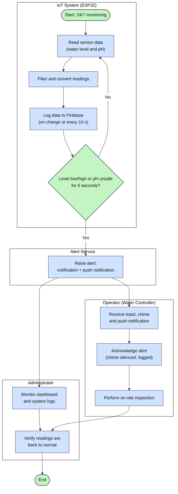
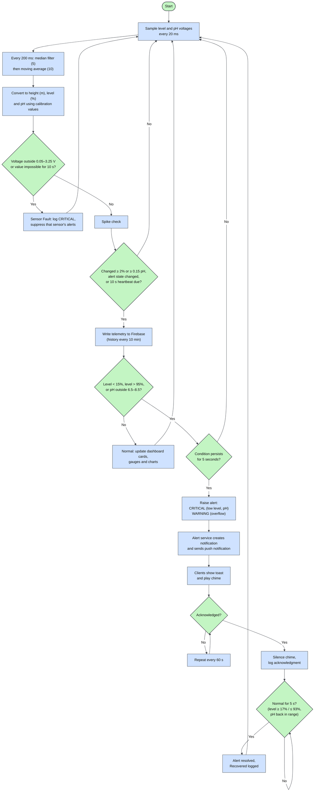
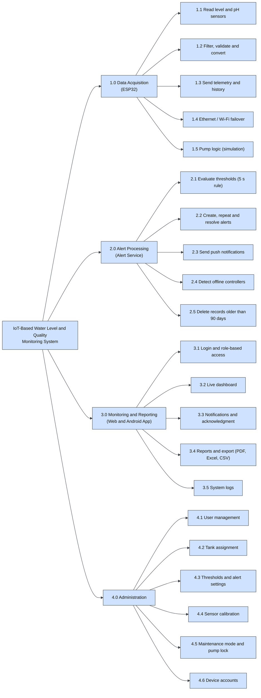
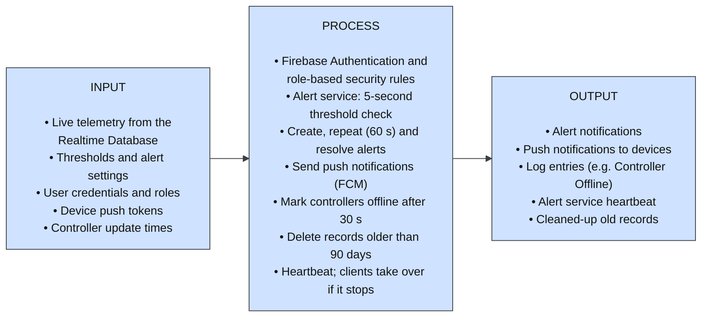
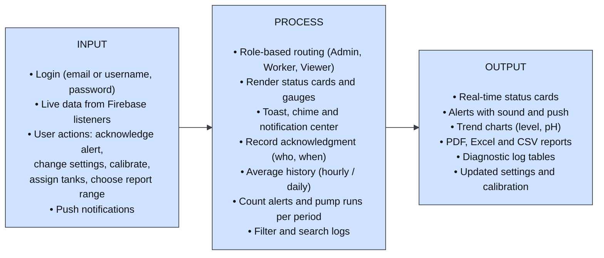
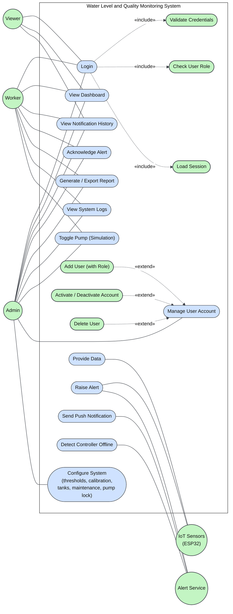
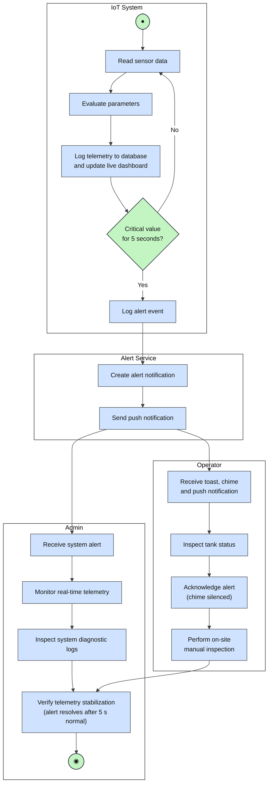
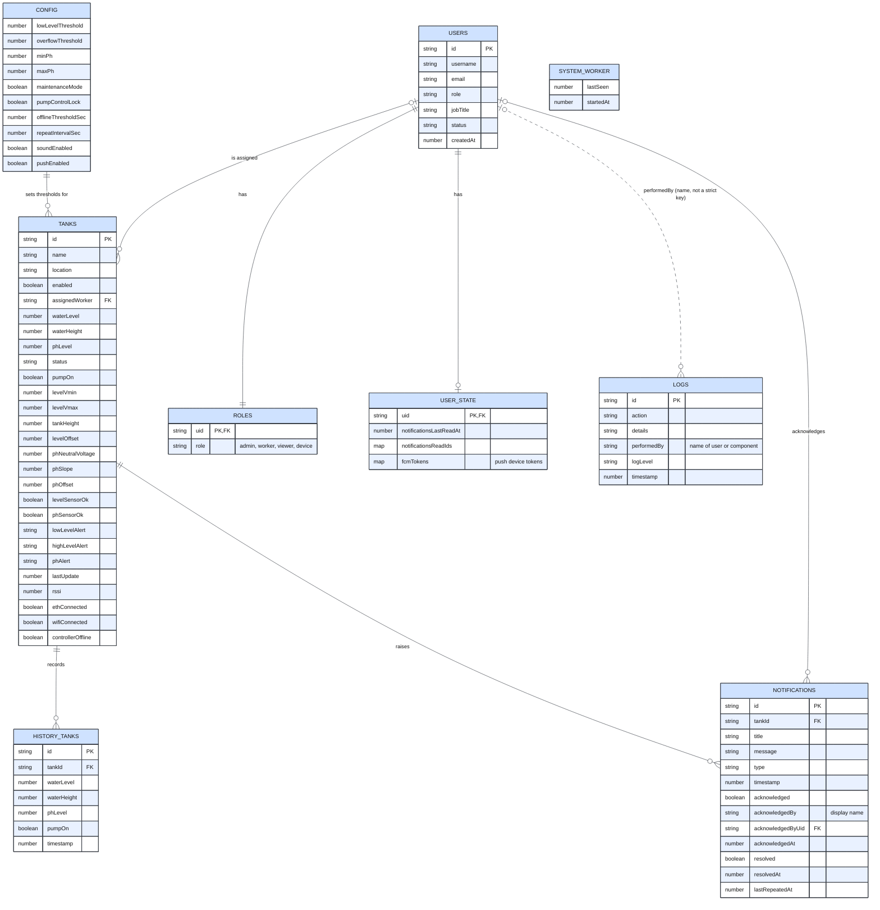
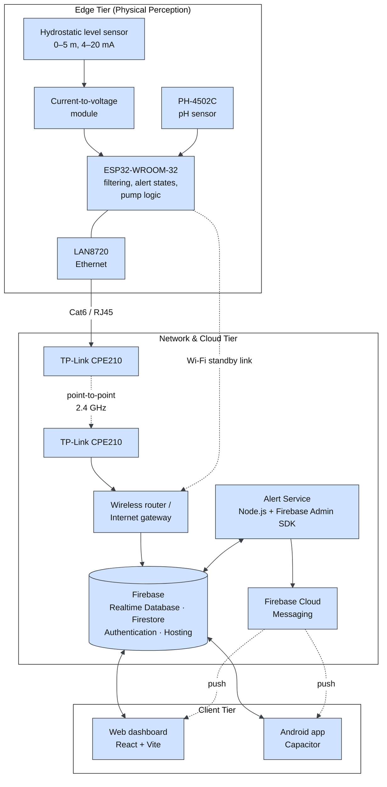
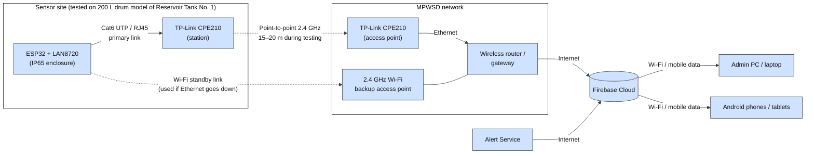

# Updated Diagrams for Chapter 3

These replace the figures that no longer match the system. Each one is written in **Mermaid**.

**To get an image for Word:**
- **Easiest:** open `docs/diagrams/diagrams.html` in your browser (double-click it). It shows every diagram with **Download SVG** and **Download PNG** buttons.
- **Or:** copy a code block into <https://mermaid.live>, then use **Actions → PNG / SVG**.

You can also redraw them in draw.io or Canva using these as the exact content.

Only the figures that contradict the system are here. Figures 3-1 to 3-3 and 3-7 already match and stay as they are.

| Figure | What is wrong in the current figure | Paper edit |
|---|---|---|
| 3-4 Proposed Operational Workflow | Alert branch skips logging; no alert service or push | 3.1 |
| 3-5 System Data Processing and Logic Flowchart | Overflow shown as CRITICAL; ESP32/SystemMonitor broadcast alerts; no push, repeat or recovery | 3.3 |
| 3-6 HIPO | No alert service module | 3.4 |
| 3-8 IPO: Backend Server and Application Logic | Alerts issued by ESP32/clients; no alert service, push, offline detection or retention | 3.4 |
| 3-9 IPO: Web Dashboard and Mobile Application | Logs exported from the Logs page; tank assignments in Firestore; no push | 3.5, 3.6 |
| 3-10 Use Case Diagram | Has Edit User / Assign Role; missing Worker and Viewer use cases; no Alert Service | 3.7–3.10 |
| 3-11 Activity Diagram | Alert branch skips logging; no Alert Service lane | 3.1 |
| 3-12 ERD | Missing ROLES, USER_STATE, SYSTEM_WORKER, fields and correct relationships | 3.11–3.13 |
| 3-13 Architectural Design | No alert service or push; sensor wiring | 3.14, 4.1 |
| 3-14 Network Design Topology | Wi-Fi "only activates" on failure; reservoir test site | 3.15, 4.28 |

---|---|
| 3-4 Proposed Operational Workflow | Readings are logged in both branches; alert service and push added |
| 3-5 System Data Processing and Logic Flowchart | Real filter stages, heartbeat, 5-second rule, alert service, push, repeat/resolve |
| 3-6 HIPO | Alert service module added; admin functions match the system |
| 3-7 IPO: IoT System | Deadband/heartbeat, pump simulation, failover, log buffer |
| 3-8 IPO: Backend Server and Application Logic | Alert service, push, offline detection, retention |
| 3-9 IPO: Web Dashboard and Mobile Application | Push, acknowledgment location, reports and exports |
| 3-10 Use Case Diagram | No Edit User / Assign Role; Worker and Viewer use cases; Alert Service actor |
| 3-11 Activity Diagram | Logging in both branches; Alert Service lane |
| 3-12 ERD | ROLES, USER_STATE, SYSTEM_WORKER; missing fields; corrected relationships |
| 3-13 Architectural Design | Alert Service, FCM, real hardware parts |
| 3-14 Network Design Topology | Wi-Fi standby link, 15–20 m test link, drum test site |

---

## Figure 3-4: Proposed Operational Workflow of MPWSD

## Figure 3-5: System Data Processing and Logic Flowchart

## Figure 3-6: Hierarchical Input-Process-Output (HIPO) Model

## Figure 3-8: IPO Model for Backend Server and Application Logic

## Figure 3-9: IPO Model for Web Dashboard and Mobile Application

## Figure 3-10: Use Case Diagram

Notes for the figure: Worker's **Toggle Pump** applies only to the tank assigned to them and only when the Pump Control Lock is off.

## Figure 3-11: Activity Diagram

## Figure 3-12: Entity-Relationship Diagram (ERD)

Notes for the figure: USERS is stored in Cloud Firestore; all other entities are in the Firebase Realtime Database. SYSTEM_WORKER is the alert service's heartbeat and has no relationships.

## Figure 3-13: Architectural Design of the System

## Figure 3-14: Network Design Topology

