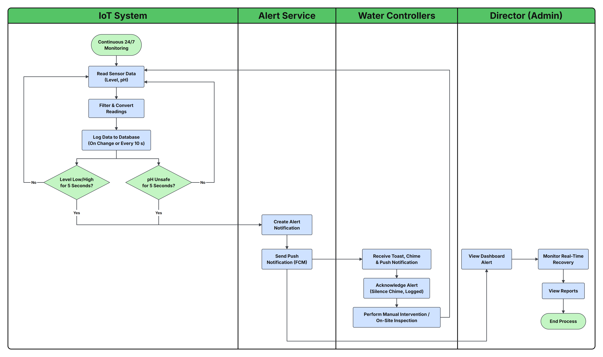
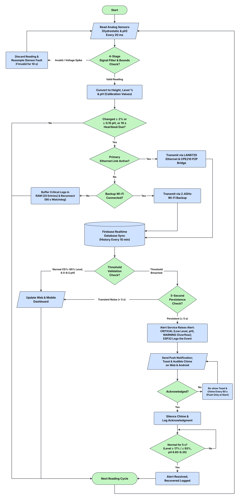
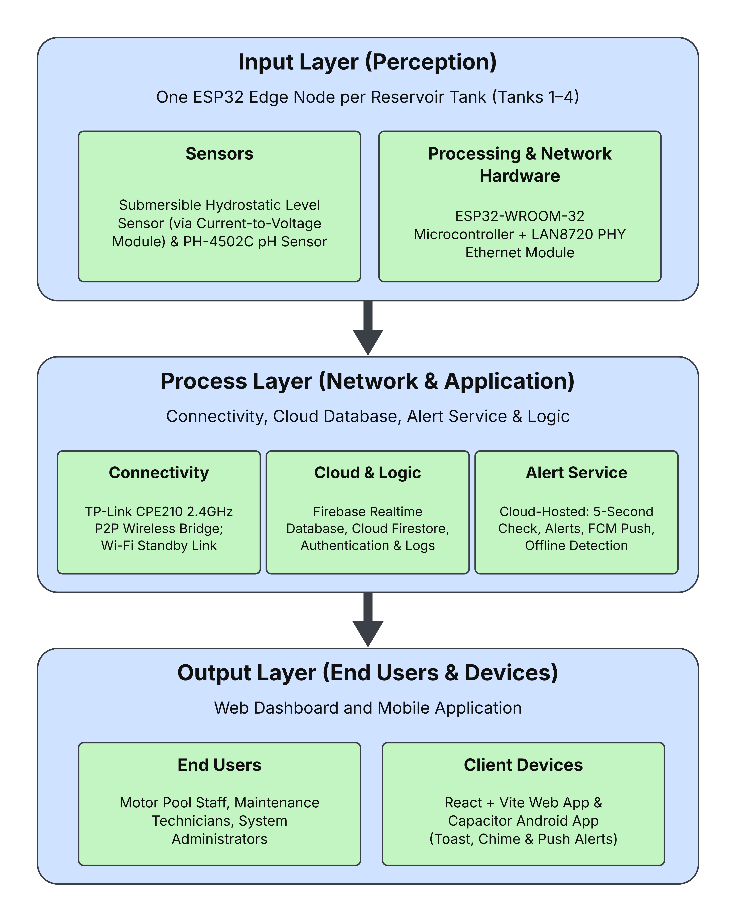
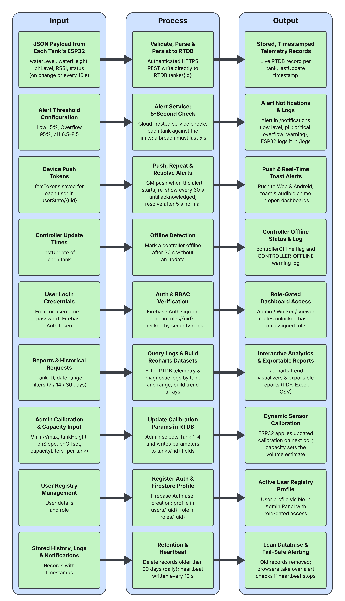
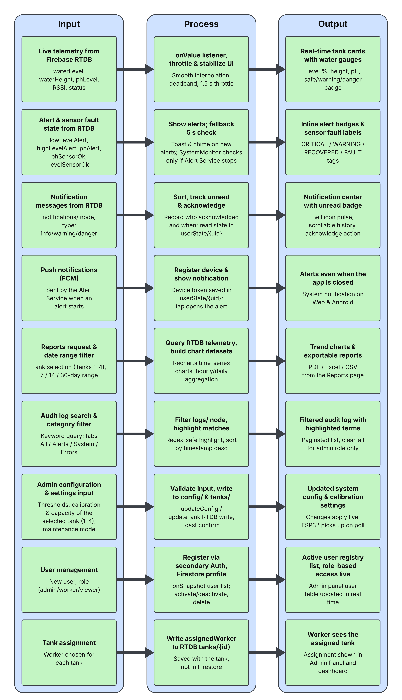
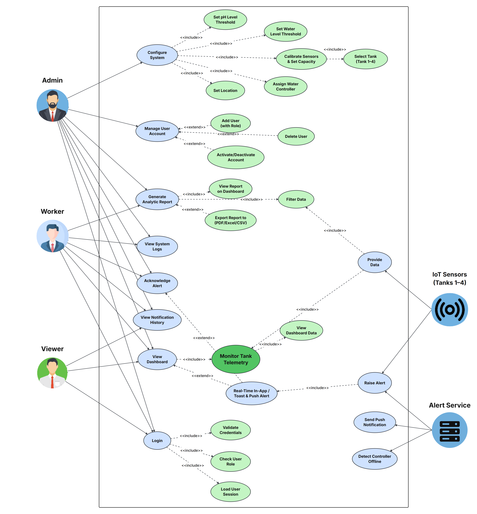
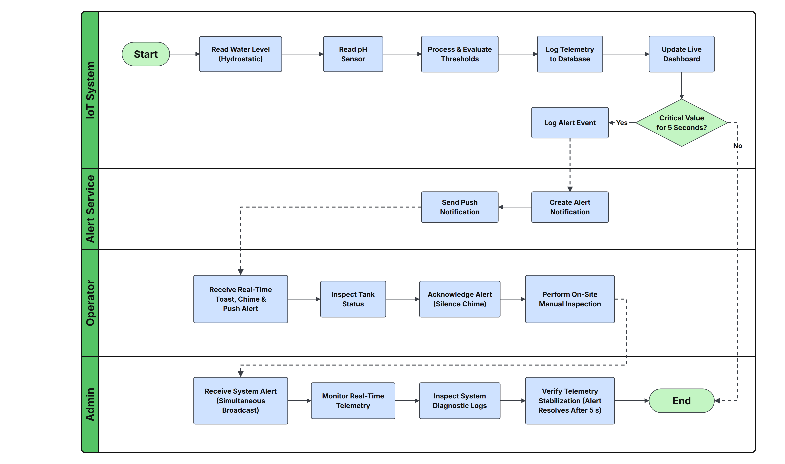
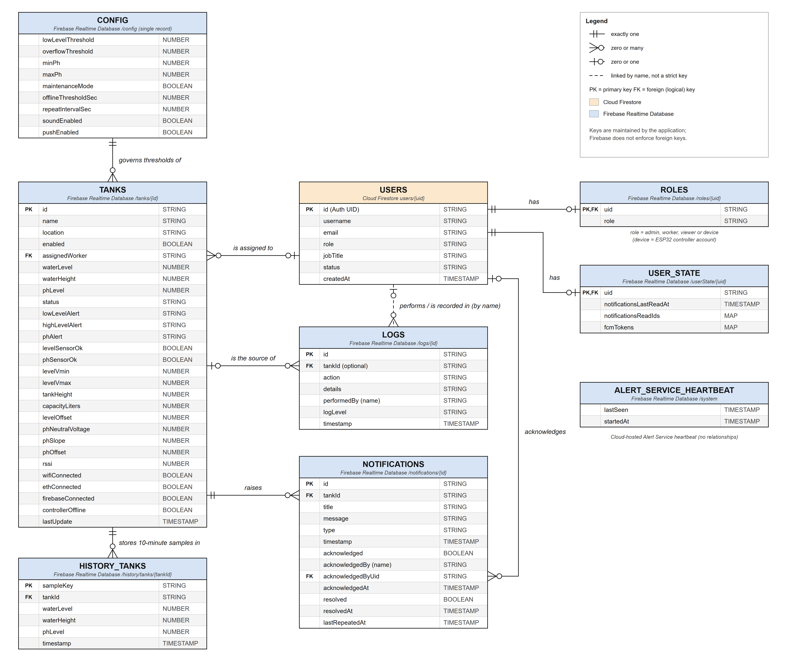
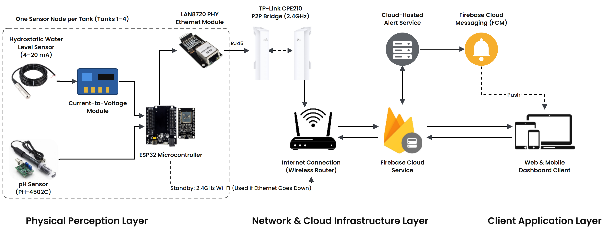
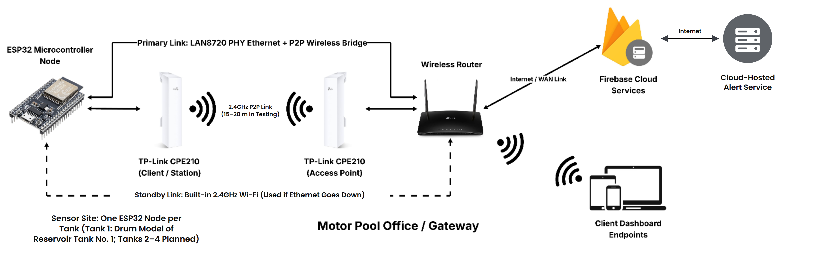

# Updated Diagrams for Chapter 3

These replace the figures that no longer match the system. They keep the design of the original thesis figures (same layout, colors, fonts, avatars and photos); only the content that was wrong changed.

**To put a figure in Word:** use the PNG in `docs/diagrams/images/` (Insert → Pictures), or open `docs/diagrams/diagrams.html` in a browser to see them all with download links.

**To change a figure:** edit `figures.mjs`, then run `node docs/diagrams/build.mjs` (one-time setup: `npm i --no-save --prefix docs/diagrams puppeteer-core`). It needs Microsoft Edge and an internet connection for the fonts.

Only the figures that contradict the system are here. Figures 3-1 to 3-3 and 3-7 already match and stay as they are.

| Figure | What is wrong in the current figure | Paper edit |
|---|---|---|
| 3-4 Proposed Operational Workflow | Alert branch skips logging; no alert service or push | 3.1 |
| 3-5 System Data Processing and Logic Flowchart | Overflow shown as CRITICAL; ESP32/SystemMonitor broadcast alerts; no push, repeat or recovery | 3.3 |
| 3-6 HIPO | No alert service module | 3.4 |
| 3-8 IPO: Backend Server and Application Logic | Alerts issued by ESP32/clients; no alert service, push, offline detection or retention | 3.4 |
| 3-9 IPO: Web Dashboard and Mobile Application | Logs exported from the Logs page; tank assignments in Firestore; no push | 3.5, 3.6 |
| 3-10 Use Case Diagram | Has Edit User / Assign Role; missing Worker and Viewer use cases; no Alert Service | 3.7–3.10 |
| 3-11 Activity Diagram | Alert branch skips logging; no Alert Service lane | 3.1 |
| 3-12 ERD | Missing ROLES, USER_STATE, the Alert Service heartbeat, fields and correct relationships | 3.11–3.13 |
| 3-13 Architectural Design | No alert service or push; sensor wiring | 3.14, 4.1 |
| 3-14 Network Design Topology | Wi-Fi "only activates" on failure; reservoir test site | 3.15, 4.28 |

**What each new figure shows**

| Figure | What changed |
|---|---|
| 3-4 Proposed Operational Workflow | Readings are logged in both branches; alert service and push added |
| 3-5 System Data Processing and Logic Flowchart | Real filter stages, heartbeat, 5-second rule, alert service, push, repeat/resolve |
| 3-6 HIPO | Alert Service added to the Process Layer; current-to-voltage module in the sensors |
| 3-8 IPO: Backend Server and Application Logic | Alert service, push, offline detection, retention |
| 3-9 IPO: Web Dashboard and Mobile Application | Push, acknowledgment location, reports and exports |
| 3-10 Use Case Diagram | No Edit User / Assign Role; Worker and Viewer use cases; Alert Service actor; no pump toggle |
| 3-11 Activity Diagram | Logging in both branches; Alert Service lane |
| 3-12 ERD | ROLES, USER_STATE, ALERT_SERVICE_HEARTBEAT; missing fields; corrected relationships; no pump fields |
| 3-13 Architectural Design | Alert Service, FCM, real hardware parts |
| 3-14 Network Design Topology | Wi-Fi standby link, 15–20 m test link, drum test site |

**Final alignment (2026-11-14):** the system supports up to four tanks (Tanks 1–4), each with its own ESP32 controller, calibration, capacity and history; Tank 1 was tested on a 200-liter drum model of Reservoir Tank No. 1. The Alert Service is cloud-hosted, so no figure says "Node.js" or "worker" for it.

| Figure | Changed in the final alignment |
|---|---|
| 3-5 System Data Processing and Logic Flowchart | Only critical logs are buffered (20 entries); the ESP32 logs the event; push only when the alert starts, toast and chime re-shown every 60 s; pH recovery 6.65–8.35 |
| 3-6 HIPO | One ESP32 edge node per tank (Tanks 1–4); Alert Service shown as cloud-hosted |
| 3-8 IPO: Backend Server and Application Logic | Each tank's ESP32; cloud-hosted service checks every tank; alert written to /notifications and logged by the ESP32; push at alert start; per-tank calibration and capacity |
| 3-9 IPO: Web Dashboard and Mobile Application | Tank selection (Tanks 1–4) in Reports; log category tabs; calibration and capacity of the selected tank |
| 3-10 Use Case Diagram | Calibrate Sensors & Set Capacity includes Select Tank (Tank 1–4); IoT Sensors (Tanks 1–4) |
| 3-12 ERD | TANKS.capacityLiters and firebaseConnected; LOGS.tankId with a TANKS–LOGS link; ALERT_SERVICE_HEARTBEAT; USERS to ROLES is zero or one (ROLES also holds device accounts) |
| 3-13 Architectural Design | "One Sensor Node per Tank (Tanks 1–4)" group; Cloud-Hosted Alert Service |
| 3-14 Network Design Topology | Sensor site: one ESP32 node per tank, Tank 1 drum model, Tanks 2–4 planned; Cloud-Hosted Alert Service |

Pump control is out of scope (Chapter 1.4 lists Remote Pump Actuation as a limitation and Chapter 5 as future work), so no figure shows pump switching, the pump lock or pump fields, even though the code still has them.

---

## Figure 3-4: Proposed Operational Workflow of MPWSD

Adds an Alert Service lane. Readings are logged before the checks, so logging happens in both branches.

## Figure 3-5: System Data Processing and Logic Flowchart

Adds the change/heartbeat check, alert service, push, 60-second repeat, acknowledgment and recovery (17% / 93%).

## Figure 3-6: Hierarchical Input-Process-Output (HIPO) Model

Adds the Alert Service to the Process Layer and the current-to-voltage module to the sensors.

## Figure 3-8: Input-Process-Output (IPO) Model for Backend Server and Application Logic

Alerts now come from the Alert Service; adds push, offline detection, retention and heartbeat rows.

## Figure 3-9: Input-Process-Output (IPO) Model for Web Dashboard and Mobile Application

Adds push notifications; exports come from the Reports page; tank assignment is stored in the Realtime Database.

## Figure 3-10: Use Case Diagram for the Water Level and Quality Monitoring System

Removes Edit User and Assign Role; adds View System Logs, View Notification History and the Alert Service actor.

## Figure 3-11: Activity Diagram

Adds an Alert Service lane; telemetry is logged before the decision.

## Figure 3-12: Entity-Relationship Diagram (ERD)

Adds ROLES, USER_STATE and ALERT_SERVICE_HEARTBEAT, the missing fields (including each tank's capacityLiters and LOGS.tankId), and TANKS raises NOTIFICATIONS and is the source of LOGS. No pump fields.

## Figure 3-13: Architectural Design of the System

Adds the current-to-voltage module, the CPE210 bridge pair, the cloud-hosted Alert Service and Firebase Cloud Messaging; the sensor node is repeated for each tank (Tanks 1–4).

## Figure 3-14: Network Design Topology

Wi-Fi is a standby link; one ESP32 node per tank, with Tank 1 tested on the drum model and Tanks 2–4 planned; the P2P link was 15–20 m in testing; adds the cloud-hosted Alert Service.
